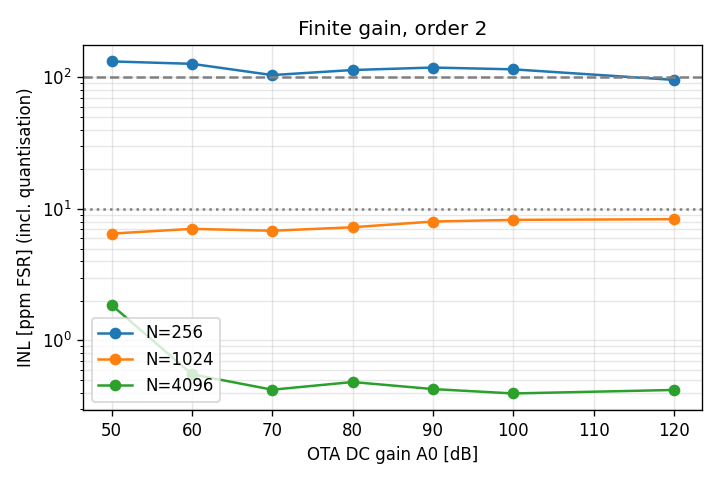
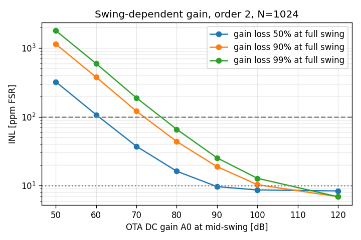

# Study: OTA DC gain

Order 2, both OTAs at A0, no noise. INL is endpoint-fit over ±0.9·VREF and includes quantisation error (floor at high A0). Gain error is linear and calibratable.

| N | A0 dB | INL ppm | gain err ppm | offset ppm |
|---|---|---|---|---|
| 256 | 50 | 132.4 | -3540 | 0.0 |
| 256 | 60 | 126.8 | -1294 | 0.0 |
| 256 | 70 | 104.2 | -545 | 0.0 |
| 256 | 80 | 113.8 | -340 | 0.0 |
| 256 | 90 | 118.9 | -272 | 0.0 |
| 256 | 100 | 115.2 | -272 | 0.0 |
| 256 | 120 | 95.7 | -204 | 0.0 |
| 1024 | 50 | 6.5 | -3196 | 0.0 |
| 1024 | 60 | 7.1 | -1011 | 0.0 |
| 1024 | 70 | 6.8 | -332 | 0.0 |
| 1024 | 80 | 7.3 | -115 | 0.0 |
| 1024 | 90 | 8.0 | -48 | 0.0 |
| 1024 | 100 | 8.3 | -26 | 0.0 |
| 1024 | 120 | 8.4 | -18 | 0.0 |
| 4096 | 50 | 1.9 | -3168 | 0.0 |
| 4096 | 60 | 0.6 | -1003 | 0.0 |
| 4096 | 70 | 0.4 | -318 | 0.0 |
| 4096 | 80 | 0.5 | -101 | 0.0 |
| 4096 | 90 | 0.4 | -33 | 0.0 |
| 4096 | 100 | 0.4 | -11 | 0.0 |
| 4096 | 120 | 0.4 | -2 | 0.0 |

## Swing-dependent gain (realistic)

A(x) = A0·(1 − drop·(x/1.2)²), N=1024. drop=0.9 means the OTA keeps only 10 % of its gain at the edge of the integrator swing.

| drop | A0 dB | INL ppm | gain err ppm |
|---|---|---|---|
| 0.5 | 50 | 322.2 | -4538 |
| 0.5 | 60 | 107.0 | -1450 |
| 0.5 | 70 | 37.2 | -465 |
| 0.5 | 80 | 16.2 | -158 |
| 0.5 | 90 | 9.6 | -60 |
| 0.5 | 100 | 8.6 | -31 |
| 0.5 | 120 | 8.4 | -18 |
| 0.9 | 50 | 1138.0 | -7570 |
| 0.9 | 60 | 377.1 | -2447 |
| 0.9 | 70 | 120.6 | -777 |
| 0.9 | 80 | 43.7 | -260 |
| 0.9 | 90 | 18.8 | -94 |
| 0.9 | 100 | 10.3 | -39 |
| 0.9 | 120 | 6.9 | -18 |
| 0.99 | 50 | 1787.0 | -9598 |
| 0.99 | 60 | 594.1 | -3136 |
| 0.99 | 70 | 188.3 | -998 |
| 0.99 | 80 | 65.8 | -332 |
| 0.99 | 90 | 25.3 | -115 |
| 0.99 | 100 | 12.8 | -48 |
| 0.99 | 120 | 6.9 | -18 |

