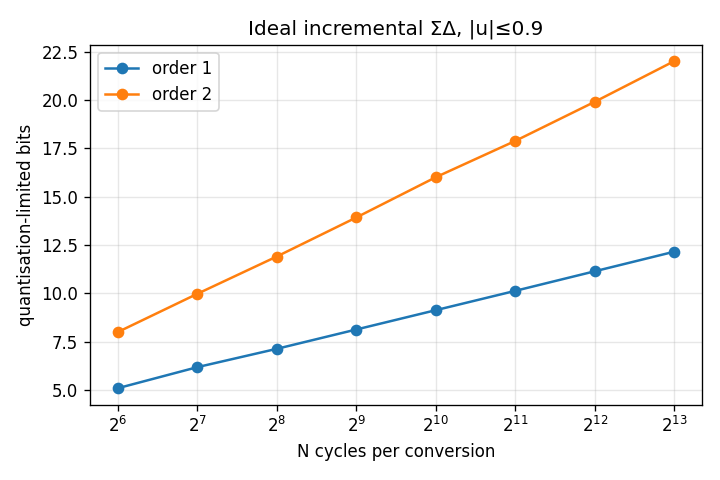

# Study: quantisation vs N

Ideal loop, c1=0.25 c2=0.5 k=1, 801-point DC sweep over ±0.9·VREF. Bits = log2(1/max|err|) (peak error = ½ LSB over FSR 2).

| order | N | rate @1 MHz | bits | max|x1| | max|x2| |
|---|---|---|---|---|---|
| 1 | 64 | 15625 | 5.1 | 0.47 | 0.00 |
| 1 | 128 | 7812 | 6.2 | 0.47 | 0.00 |
| 1 | 256 | 3906 | 7.1 | 0.47 | 0.00 |
| 1 | 512 | 1953 | 8.1 | 0.47 | 0.00 |
| 1 | 1024 | 977 | 9.1 | 0.47 | 0.00 |
| 1 | 2048 | 488 | 10.1 | 0.47 | 0.00 |
| 1 | 4096 | 244 | 11.1 | 0.47 | 0.00 |
| 1 | 8192 | 122 | 12.2 | 0.47 | 0.00 |
| 2 | 64 | 15625 | 8.0 | 1.17 | 1.16 |
| 2 | 128 | 7812 | 10.0 | 1.17 | 1.19 |
| 2 | 256 | 3906 | 11.9 | 1.17 | 1.19 |
| 2 | 512 | 1953 | 13.9 | 1.17 | 1.19 |
| 2 | 1024 | 977 | 16.0 | 1.17 | 1.19 |
| 2 | 2048 | 488 | 17.9 | 1.17 | 1.19 |
| 2 | 4096 | 244 | 19.9 | 1.18 | 1.21 |
| 2 | 8192 | 122 | 22.0 | 1.18 | 1.21 |

